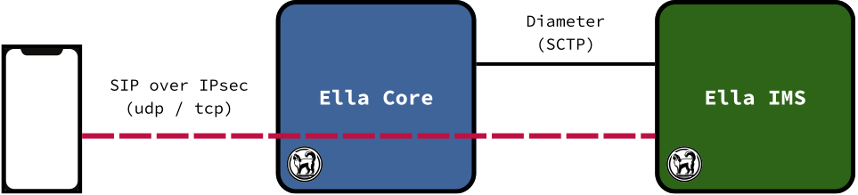

# Ella IMS (beta)

**Ella IMS** lets subscribers of a private 4G or 5G network make voice and video calls. It is an IP Multimedia Subsystem (IMS) that runs as a single application. It is designed to be easy to operate, reliable, and secure.

<p align="center">
  
</p>

[](https://snapcraft.io/ella-ims)

## Key Features

- Voice & Video calls
- SIM-based phone authentication with your existing HSS (IMS-AKA over Cx)
- IPsec between phones and the IMS
- Voice QoS from the 4G or 5G core (PCRF over Rx, or PCF over N5 with optional mutual TLS)
- Application Servers (AS): connect voicemail, conferencing, MCPTT, supplementary services and other value-added services, with per-subscriber routing driven by your HSS (iFCs over ISC)
- Push-to-talk: a built-in MCPTT server for group calls with floor control (TS 24.379, TS 24.380), and an Android client
- Call records: who called whom, when, for how long and how the call ended
- Complete IMS core in a single binary (P-CSCF, I-CSCF, S-CSCF)
- Embedded database (SQLite)
- Web UI and HTTP API
- Prometheus metrics

## How-to Guides

### Install

```sh
sudo snap install ella-ims
sudo snap connect ella-ims:network-control
sudo vi /var/snap/ella-ims/common/ims.yaml
sudo snap start --enable ella-ims.imsd
```

### Integrate with Ella Core

1. In Ella Core's configuration file, set the Diameter address and restart Ella Core:

   ```yaml
   interfaces:
     diameter:
       address: "10.3.0.2"
   ```

2. In `ims.yaml`, set the address phones reach Ella IMS on, and the address it reaches Ella Core from, then restart Ella IMS:

   ```yaml
   sip:
     addresses: [10.6.0.5]
   diameter:
     address: 10.3.0.5
   ```

3. In the Ella IMS UI (`http://<ims>:5020`), go to the **Operator** page:
   - Click the edit icon next to **Operator ID (MCC/MNC)**, enter Ella Core's MCC and MNC, e.g. `001` / `01`, and click **Update**.
   - Click the edit icon next to **Numbering Plan**, enter your country code and prefixes, and click **Update**.

4. Go to the **Cores** page:
   - Under **Peers**, click **Add Peer**, enter Ella Core's Diameter address, e.g. `10.3.0.2`, check **HSS** and **PCRF**, and click **Add**.
   - Under **HSS**, click the edit icon next to **HSS Realm**, enter `epc.mnc001.mcc001.3gppnetwork.org`, and click **Update**.

5. Under **Voice QoS**, on the same page:
   - Click the edit icon next to **Policy Function**, select **PCRF**, and click **Update**.
   - Click the edit icon next to **PCRF Realm**, enter `epc.mnc001.mcc001.3gppnetwork.org`, and click **Update**.

6. Route the phones' `ims` IP pool through Ella Core's N6 address:

   ```sh
   sudo ip route add 10.46.0.0/16 via 10.6.0.2
   ```

7. In Ella Core, follow steps 3 to 9 of [Enable Voice][ella-core-voice], with `10.6.0.5` as the P-CSCF address.

### Integrate with an Application Server

Prerequisite: an HSS that provisions iFCs.

1. In `ims.yaml`, add the AS's addresses to the trusted networks, and optionally set how long the AS has to answer, then restart Ella IMS:

   ```yaml
   sip:
     trusted_networks: [10.80.0.30/32]
   scscf:
     as_timeout: 4s
   ```

2. In the HSS, add iFCs to the subscribers' service profiles, with the AS's SIP URI as the server name, e.g. `sip:10.80.0.30:5060`:
   - For third-party registration, add a trigger point on method `REGISTER`. Set Include Register Request and Include Register Response if the AS needs them.
   - For originating or terminating services, add a trigger point on the session case, plus the method, header or Request-URI to match.
   - Set the default handling to `SESSION_CONTINUED` for calls to go on without the AS, or to `SESSION_TERMINATED` for them to fail.

3. If the AS serves its own URIs, such as a conference factory, add its PSIs to the HSS, distinct or wildcarded, with their iFCs or the AS as their server name.

4. Make the PSIs' host resolve to the AS (DNS A or SRV record).

5. On the AS:
   - Trust Ella IMS's SIP address, e.g. `10.6.0.5`.
   - Send requests to a user to the I-CSCF, port `5070`.
   - Send requests on behalf of a user or a PSI to the S-CSCF, port `5080`, with `orig` in the Route (`Route: <sip:10.6.0.5:5080;lr;orig>`) and the user in P-Served-User or P-Asserted-Identity.

6. Register a phone, then check the AS received a third-party REGISTER or the first matching request.

### Enable push-to-talk (MCPTT)

Prerequisites: an HSS that provisions iFCs, and phones whose SIMs allow the Android app's signing certificate ([Signing](android/README.md#signing)).

1. In `ims.yaml`, set the address phones reach the MCPTT media on, then restart Ella IMS:

   ```yaml
   mcptt:
     media:
       address: 10.6.0.5
   ```

2. Get the server name of the MCPTT server:

   ```sh
   curl -s http://localhost:5020/api/v1/status | jq -r .result.mcptt.name
   ```

3. In the HSS, add an application server of that server name, e.g. `sip:mcptt.ims.mnc001.mcc001.3gppnetwork.org`, without PSIs. Add two iFCs to the subscribers' service profiles, with a lower priority value than any MMTel iFC:
   - A trigger point on method `REGISTER`, with Include Register Request and Include Register Response, and default handling `SESSION_CONTINUED`.
   - A trigger point on the originating session case and the `P-Asserted-Service` header `urn:urn-7:3gpp-service.ims.icsi.mcptt`, with default handling `SESSION_TERMINATED`.

4. Provision users and groups:

   ```sh
   api=http://localhost:5020/api/v1/mcptt
   curl -X POST $api/users -d '{"mcptt_id": "sip:alice@mcptt.example.com", "impus": ["sip:15550000001@ims.mnc001.mcc001.3gppnetwork.org"]}'
   curl -X POST $api/groups -d '{"group_id": "sip:fire@mcptt.example.com", "invite_members": true,
     "maximum_duration_ms": 600000, "members": [{"mcptt_id": "sip:alice@mcptt.example.com"}]}'
   curl -X PUT $api/users/sip:alice@mcptt.example.com -d '{"impus": ["sip:15550000001@ims.mnc001.mcc001.3gppnetwork.org"],
     "implicit_affiliations": ["sip:fire@mcptt.example.com"]}'
   ```

5. Install the Android app (`android/`) on the phones, and set each user's MCPTT ID and groups in its settings.

6. Start a group call from one phone, then check the others ring.

### Build

#### From source

```sh
npm install --prefix ui
npm run build --prefix ui
go build -o ims -ldflags "-s -w -X github.com/ellanetworks/ims/version.GitCommit=$(git rev-parse HEAD)" ./cmd/ims
```

#### Container Image

```sh
rockcraft pack
```

#### Snap

```sh
snapcraft pack
```

#### Android app

See [`android/README.md`](android/README.md).

### Run

```sh
sudo ./ims --config ims.yaml
```

### Test

#### Unit and integration tests

```sh
go test ./...
(cd sip && go test ./...)
npm test --prefix ui
```

#### End-to-end tests

```sh
sudo modprobe -a sctp esp4 xfrm_user
cd e2e
E2E_RAT=4g ./up.sh
E2E_RAT=4g ./run.sh
```

For 5G, set `E2E_RAT=5g`.

#### Load tests

On Linux:

```sh
ulimit -n 200000
go test ./internal/mcptt -run '^$' -bench '^BenchmarkRegistration$' -benchtime 1000x -count 3
go test ./internal/mcptt -run '^$' -bench '^BenchmarkGroupCalls$' -benchtime 1x -count 3
```

#### Fuzz tests

```sh
cd sip
go test -run='^$' -fuzz='^FuzzParse$' .
```

## Reference

### Configuration File

See [`ims.yaml`](ims.yaml).

The `mcptt` section, absent by default:

| Key | Default | Description |
| --- | --- | --- |
| `mcptt.media.address` | (required) | Address of the media sockets |
| `mcptt.media.advertise` | `mcptt.media.address` | Address in the SDP; required if `address` is unspecified |
| `mcptt.media.min_port` | `20000` | First port of the voice legs, even |
| `mcptt.media.max_port` | `20999` | Last port of the voice legs |
| `mcptt.media.control_port` | `21000` | Port of the floor control channels, outside the legs' range |
| `mcptt.mode` | `ims` | `ims`, or `direct` for the lab: the MCPTT server is the phones' registrar |
| `mcptt.port` | `5090` | SIP port of the MCPTT server on each `sip.addresses` |

### API

[`openapi.yaml`](internal/api/openapi.yaml), served at `GET /api/v1/openapi.yaml`. MCPTT: `/api/v1/mcptt/`.

### Metrics

Prometheus metrics, served at `GET /api/v1/metrics`.

| Metric | Type | Description |
| --- | --- | --- |
| `ellaims_build_info` | Gauge | Always 1; the version and revision of the running build are in its labels |
| `ellaims_registered_subscribers` | Gauge | Subscribers registered now |
| `ellaims_registration_attempts_total` | Counter | Registrations and re-registrations, by result (`accept`, `auth_failure`, `reject`) |
| `ellaims_active_calls` | Gauge | Calls in progress |
| `ellaims_calls_total` | Counter | Calls that ended, by outcome (`answered`, `cancelled`, `busy`, `rejected`, `no_answer`, `unavailable`, `failed`) |
| `ellaims_sip_responses_total` | Counter | Final responses the P-CSCF sent to phones, by method and status class |
| `ellaims_diameter_peer_up` | Gauge | 1 if the connection to a Diameter peer (HSS, PCRF) is open, by peer and application |
| `ellaims_peer_requests_total` | Counter | Requests to the HSS and the policy function, by interface (`cx`, `rx`, `n5`) and result (`success`, `failure`, `error`, `timeout`) |
| `ellaims_peer_request_duration_seconds` | Histogram | How long requests to the HSS and the policy function take, by interface |
| `ellaims_database_query_duration_seconds` | Histogram | How long database calls take, by connection pool (`write`, `read`) |
| `ellaims_database_query_errors_total` | Counter | Database calls that failed, by connection pool |
| `ellaims_database_storage_bytes` | Gauge | Size of the database on disk, by file (`main`, `wal`) |
| `go_*` | Gauge, Counter, Summary | Go runtime health: goroutines, heap, garbage-collection pauses |
| `process_*` | Gauge, Counter | Process health: memory, CPU, open file descriptors, start time |

### Compatibility

Validated against:

#### Core Networks

- [Ella Core][ella-core]
- Open5GS

#### MCPTT Clients

- Ella MCPTT for Android (`android/`)

#### Phones

- Apple iPhone 11
- Apple iPhone 16
- Crosscall Core-Z5
- Google Pixel 10a
- Motorola Moto G 5G
- Samsung Galaxy A56

#### Phone Quirks

| Phone              | RAT | Observed                                                                           |
|--------------------|-----|------------------------------------------------------------------------------------|
| Apple iPhone 11    | 4G  | Live Voicemail answers declined and unanswered calls (`200 OK`)                    |
| Apple iPhone 16    | 4G  | Live Voicemail answers declined and unanswered calls (`200 OK`)                    |
|                    | 4G  | 3 IMS addresses in 6 minutes                                                       |
|                    | 4G  | No video calls: registers with `audio` only, no `video` feature tag                |
|                    | 5G  | 5G SA unavailable without SUCI on the SIM (USIM service 124, `EF.SUCI_Calc_Info`) |
|                    | 5G  | Rejects NEA0 (Security Mode Reject, cause 24)                                      |
|                    | 5G  | SIM PLMN 001/01: never attempts the 5G SA cell                                     |
|                    | 5G  | SIM PLMN 999/01: data only, no voice settings, no IMS PDU session                  |
| Google Pixel 10a   | 4G  | Video call to an iPhone: dialer offers Google Meet instead                         |
| Motorola Moto G 5G | 5G  | SIM PLMN 999/01: 5G SA only with network type "NR only"                            |
|                    | 5G  | Video call answered without a camera, then switched to `recvonly` (once in 5)      |
|                    | 4G  | SIM PLMN 999/01: IMS doesn't start                                                 |
| Samsung Galaxy A56 | 4G  | SIM PLMN 001/01: VoLTE off (`LABSIM` profile, TS.43 entitlement 403)               |

## Explanation

### Standards

Ella IMS follows 3GPP standards: it should work with any compliant 4G or 5G core, application server and phone, beyond those it was validated against.

### Push-to-talk

The MCPTT server runs inside Ella IMS. Its server name, `sip:mcptt.<home domain>`, derives from the operator's MCC and MNC, and so do its addresses: Ella IMS routes every request to that host to it, in memory, so the HSS needs no PSI for it. Changing the MCC or MNC renames it.

### Tests

The IPsec tests use network namespaces. They are skipped where those are unavailable, and fail instead when `CI` is set.

The load tests run the MCPTT server at 1,000 registered users and 200 concurrent group calls of 100 members, in one process over loopback. They report registrations and call setups per second, and the 50th, 90th and 99th percentiles of the MCPTT access time and of the server's share of the mouth-to-ear latency (TS 22.179 §6.15.3), in milliseconds.

### IPsec

Phones reach the IMS over IPsec, which the IMS sets up in the kernel. It needs `CAP_NET_ADMIN` (run as root, or add the capability to its container).

Firewalls between phones and the IMS must pass ESP (IP protocol 50).

[ella-core]: https://github.com/ellanetworks/core
[ella-core-voice]: https://docs.ellanetworks.com/how_to/enable_voice/
