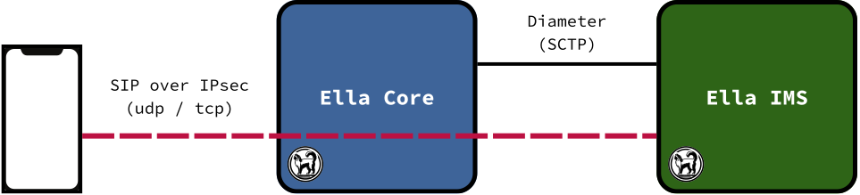

# Architecture

<figure markdown="span">
  { width="800" }
  <figcaption>Ella IMS with Ella Core</figcaption>
</figure>

An IP Multimedia Subsystem (IMS) is what lets phones on a 4G or 5G network make voice and video calls. The core network gives each phone an IP connection to the IMS. Over that connection, the phone registers and places calls with SIP, and the IMS routes them.

Ella IMS handles the signalling only. The voice and video of a call go between the phones, through the core network.

## Three CSCFs in one process

3GPP splits the IMS's SIP routing into three Call Session Control Functions (CSCFs):

- **P-CSCF**: the phone's first contact. It protects the phone's signalling with IPsec, and asks the core network for the QoS that voice and video need.
- **I-CSCF**: the entry point of the network. It asks the HSS which S-CSCF serves a user.
- **S-CSCF**: the registrar. It authenticates phones against the HSS, routes calls, and involves Application Servers when a subscriber's filter criteria say so.

In most IMS deployments, these are separate nodes. Ella IMS runs all three in one process, with one database, one UI and one API. Each CSCF still has its own SIP port, and the three exchange standard SIP messages, in memory, so from the outside Ella IMS looks like any other IMS.

## What Ella IMS relies on

Ella IMS relies on two functions of the core network:

- **The HSS** holds the subscribers: their identities, the keys to authenticate them, and the filter criteria that bring in Application Servers. Ella IMS reaches it over Diameter (Cx).
- **The policy function** has the core set up the dedicated bearers (4G) or QoS flows (5G) that carry voice and video. Ella IMS reaches it over Diameter (Rx), or a PCF over HTTP (N5).

Ella Core provides both. For how it works with an IMS, see Ella Core's [IMS Integration](https://docs.ellanetworks.com/core/explanation/ims_integration/).

## Who can call whom

Ella IMS connects calls only between the subscribers its HSS knows. It has no gateway to the PSTN or to other operators.

Ella IMS does not handle emergency calls. It refuses them with 380 (Alternative Service), as TS 24.229 §5.2.10.5 specifies for an IMS without emergency support.
