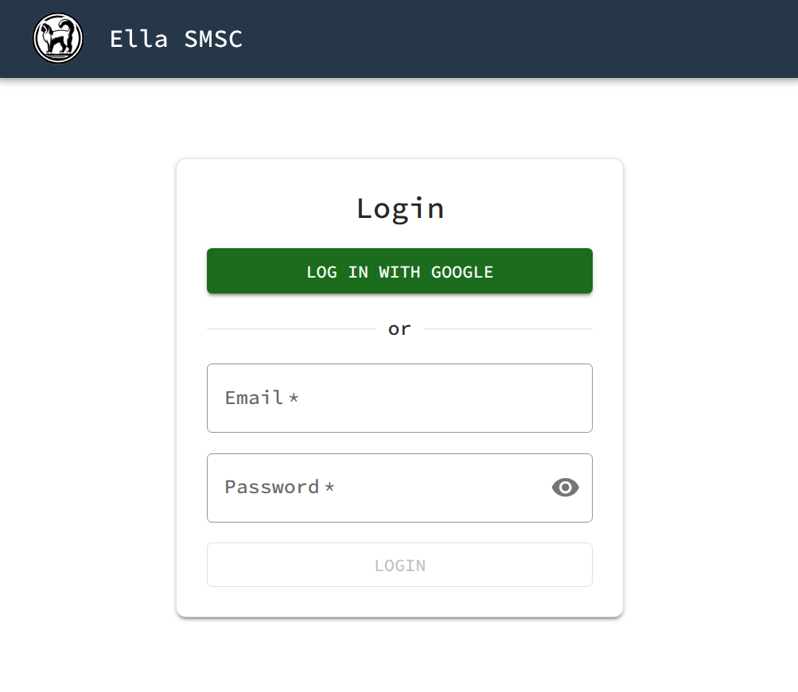

# Single Sign-On

Users can log in to the UI through the organization's identity provider instead of, or as well as, a password. Ella IMS works with any OpenID Connect identity provider, such as Microsoft Entra ID, Okta, Ping Identity, Google or Keycloak. To set it up, see [Configure single sign-on](../how_to/configure_single_sign_on.md).

<figure markdown="span">
  { width="400" }
  <figcaption>Login page with single sign-on</figcaption>
</figure>

## Password and single sign-on

| | Password | Single sign-on |
|---|---|---|
| Credentials kept by | Ella IMS | The identity provider, with its own policies, such as multi-factor authentication |
| Role set by | An Admin | An Admin, or the user's groups at the identity provider |
| Session | 30 days | The session lifetime, 24 hours by default |
| Access removed by | Deleting the user in Ella IMS, at once | Removing the user at the identity provider, at the end of their session |

Password login stays when single sign-on is on, and at least one Admin always keeps a password. An identity provider that is down or misconfigured cannot lock everyone out.

## Matching users

A user is matched to their account at the identity provider, not to their email address, so a changed or reused email address does not give access to another user. The email address is used once, to link the account at its first login, and only if the identity provider has verified it. A provider that does not say whether email addresses are verified, such as Microsoft Entra ID, must be trusted explicitly: anyone who can set their email address there could take over the matching user. An account with no user in Ella IMS gets one only from a [group mapping](../how_to/manage_single_sign_on_users.md#map-groups-to-roles).

## Offboarding

Ella IMS does not learn when someone is removed at the identity provider. Their session lasts until its lifetime ends, and their API tokens until deleted. A shorter session lifetime narrows that window, at the cost of logging in more often. To end access at once, [offboard the user](../how_to/manage_single_sign_on_users.md#offboard-a-user) in Ella IMS.

## Client secret

The identity provider's client secret is stored in the database, `db.path` in the [configuration file](../reference/config_file.md), and so in any copy of it.
