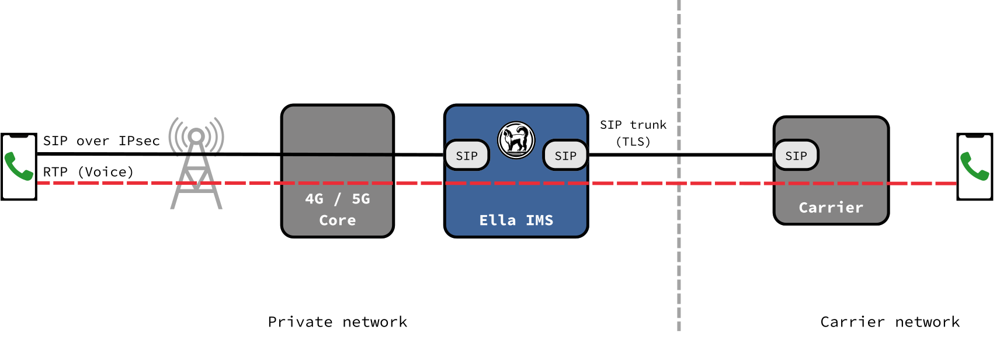

# SIP Trunks

A SIP trunk connects Ella IMS to a carrier, such as a PSTN provider or another operator's IMS. It carries calls to and from numbers outside the HSS.

<figure markdown="span">
  { width="800" }
  <figcaption>SIP trunks</figcaption>
</figure>

## The border

3GPP puts three functions at the border of an IMS:

- **BGCF**: picks the trunk a call leaves through.
- **IBCF**: the border itself. It hides the IMS from carriers, and checks what crosses.
- **TrGW**: relays the voice of the calls that cross.

Ella IMS runs all three in its one process.

## Calls out

1. A phone calls a number that the HSS doesn't know.
2. The BGCF takes the route with the longest prefix of the number, else the default route.
3. The IBCF tries the route's trunks in order. It skips trunks that are down or disabled.
4. If a trunk fails before the call rings, the IBCF tries the next server, then the next trunk.

Only numbers dialled in full go to a trunk: in international form, in national form, or long enough. Short codes stay inside the IMS.

## Calls in

1. A carrier sends a call to the IBCF.
2. The IBCF finds the trunk by the call's source address.
3. The I-CSCF routes the call to the subscriber with that number, as any other call.

## Trust

A carrier with an interconnect agreement can be trusted. Ella IMS then accepts the caller's number it asserts, and asserts its subscribers' numbers to it. From an untrusted carrier, the caller's number is only a claim. See [Security](security.md#sip-trunks).

## Voice

Ella IMS relays the voice of every call over a trunk. Phones and carriers only see Ella IMS's addresses, never each other's.

The voice is relayed as it is, without transcoding. The phone and the carrier must share a codec, such as AMR-WB, which Telnyx accepts. Phones don't offer G.711, so a carrier that accepts only G.711 needs an SBC that transcodes.

## Keepalives

Ella IMS sends OPTIONS requests to each trunk. A trunk that stops answering is down, and routes skip it until it answers again.

## What SIP trunks don't carry

- **Emergency calls.** Ella IMS doesn't handle emergency calls, and doesn't send them to a trunk.
- Video, fax and messages.
- Registration with the carrier. The carrier knows Ella IMS by its IP address.
- SRTP. Voice crosses unencrypted, even when signalling uses TLS.
