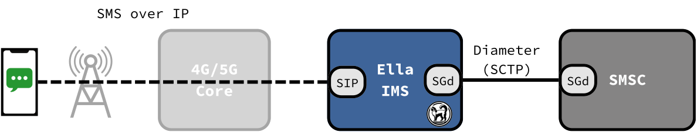

# SMS over IP

Ella IMS includes an IP Short Message Gateway (IP-SM-GW), which lets phones send and receive SMS over IMS.

<figure markdown="span">
  { width="800" }
  <figcaption>SMS over IP</figcaption>
</figure>

## Sending

1. The phone sends the SMS as a SIP MESSAGE, which reaches the IP-SM-GW through the P-CSCF and the S-CSCF.
2. The IP-SM-GW forwards it to the SMSC of the phone's service centre address.

## Receiving

1. While the phone registers with SMS over IP, the IP-SM-GW registers at the HSS for the subscriber.
2. The HSS then sends the SMSC's routing requests for the subscriber to the IP-SM-GW.
3. The IP-SM-GW delivers over IMS first, then over NAS through the MME or SMSF.
